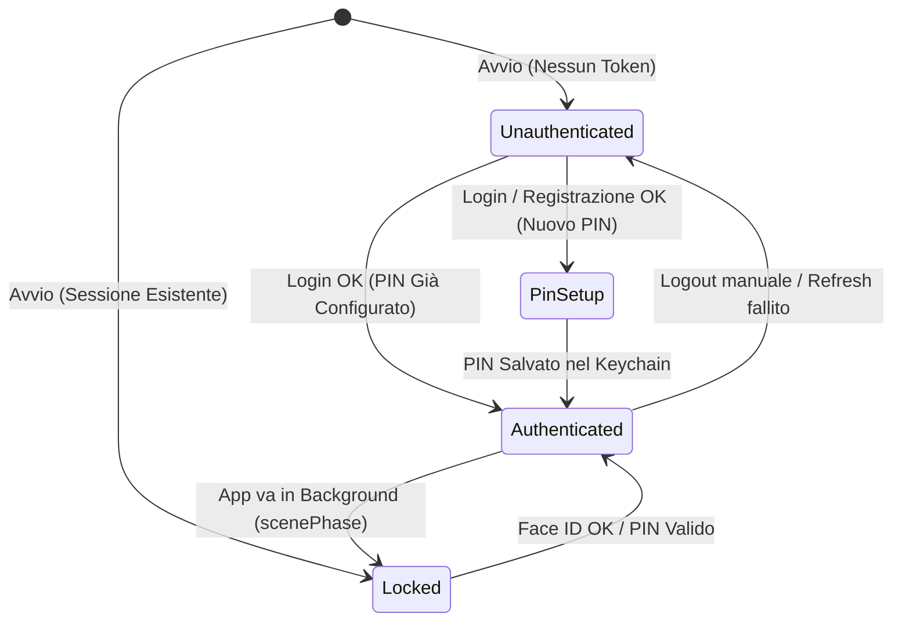

# 💳 Spendy iOS

<p align="center">
  
</p>

<p align="center">
  <strong>Gestione delle finanze personali intuitiva, elegante e sicura su iOS.</strong>
</p>

<p align="center">
  
  
  
  
  
</p>

---

## 📖 Indice

- [Panoramica](#-panoramica)
- [Funzionalità Principali](#-funzionalità-principali)
- [Architettura dell'Applicazione](#-architettura-dellapplicazione)
- [Design System & UI Components](#-design-system--ui-components)
- [Sicurezza & Autenticazione](#-sicurezza--autenticazione)
- [Struttura del Progetto](#-struttura-del-progetto)
- [Integrazione Backend & API](#-integrazione-backend--api)
- [Requisiti di Sistema](#-requisiti-di-sistema)
- [Installazione e Configurazione](#-installazione-e-configurazione)
- [Contributi e Licenza](#-contributi-e-licenza)

---

## 🌟 Panoramica

**Spendy** è un'applicazione nativa per iOS progettata per offrire un controllo completo e moderno sulle proprie finanze personali. Sviluppata interamente con **SwiftUI** e basata sull'architettura **MVVM**, combina un'interfaccia utente rifinita ad alte prestazioni (accelerata via GPU) con solidi meccanismi di sicurezza, tra cui memorizzazione token nel **Keychain**, sblocco biometrico (**Face ID / Touch ID**) e codice **PIN di emergenza**.

---

## ✨ Funzionalità Principali

### 📊 1. Dashboard Interattiva
- **Card Saldo Dinamica**: visualizzazione del saldo complessivo con gradienti tridimensionali e orb decorativi renderizzati off-screen (`.drawingGroup()`).
- **Ripartizione Entrate / Uscite**: metriche immediate calcolate sul flusso di cassa.
- **Filtri Rapidi**: switch dinamico tra *Tutte*, *Entrate* e *Uscite*.
- **Transazioni Recenti**: lista compatta delle ultime spese con accesso rapido alla vista dettagliata.
- **Skeleton Loaders**: segnaposto animati durante il caricamento dei dati per una UX fluida.

### 📈 2. Statistiche & Analytics (Swift Charts)
- **Trend Mensile delle Spese**: grafici a barre interattivi realizzati nativamente con **Swift Charts**.
- **Indicatori Chiave (KPI)**:
  - Saldo Totale del periodo
  - Spesa Media
  - Spesa più Elevata
  - Conteggio complessivo delle transazioni
- **Analisi per Categoria**: progress bar animate che evidenziano l'incidenza percentuale di ogni voce di spesa.
- **Filtri Temporali**: aggregazione per mese, anno o intervallo di date personalizzato.

### 💸 3. Gestione Completa delle Transazioni
- **Inserimento Spesa / Entrata**: form dedicato con switch intuitivo, selezione del tipo di pagamento (*Carta* o *Contanti*), data, importo e descrizione.
- **Categorizzazione Intelligente**: mapping automatico con icone SF Symbols e palette semantica dedicata (*Ristorazione*, *Supermercati*, *Carburante*, *Trasporti*, *Shopping*, *Abbonamenti*, *Viaggi*, ecc.).
- **Elenco Completo con Ricerca**: schermata *Tutte le spese* integrata con barra di ricerca nativa (`.searchable`).
- **Modifica e Cancellazione**: supporto all'editing rapido e all'eliminazione singola o massiva.

### 📥 4. Importazione Estratti Conto (CSV)
- **Upload Multipart**: caricamento diretto di file CSV bancari verso il server.
- **Area Drop Zone**: interfaccia con bordo tratteggiato e animazione di caricamento per importare batch di transazioni in pochi secondi.

### 🔐 5. Protezione & Privacy
- **PIN di Sicurezza a 6 Cifre**: tastierino numerico nativo personalizzato con feedback aptico per la configurazione e lo sblocco.
- **Biometria Nativ**: autenticazione rapida tramite **Face ID** / **Touch ID** con fallback su PIN.
- **Auto-Lock**: blocco automatico dell'app non appena passa in background (`scenePhase == .background`).

### 👤 6. Profilo & Account
- Visualizzazione dati utente e avatar generato con le iniziali.
- Aggiornamento dei dati anagrafici (Nome, Cognome).
- Gestione della sessione e logout sicuro con eliminazione delle credenziali dal Keychain.

---

## 🏗 Architettura dell'Applicazione

L'applicazione segue i principi dell'architettura **MVVM (Model-View-ViewModel)** combinata con un robusto **Service Layer** per garantire separazione delle responsabilità, testabilità e manutenibilità:

```mermaid
graph TD
    subgraph UI ["SwiftUI Views"]
        V_Auth[AuthView / PinSetup / LockView]
        V_Dash[DashboardView / AllExpensesView]
        V_Detail[ExpenseDetailView / AddExpenseView]
        V_Analytics[AnalyticsView]
        V_Profile[UserProfileView]
    end

    subgraph ViewModels ["ViewModels (@MainActor)"]
        VM_Dash[DashboardViewModel]
        VM_Analytics[AnalyticsViewModel]
    end

    subgraph Services ["Service Layer"]
        S_Auth[AuthManager (Singleton)]
        S_Expense[ExpenseService (Singleton)]
        S_Net[NetworkManager (HTTP Interceptor)]
    end

    subgraph System ["iOS System & Hardware"]
        Keychain[Keychain Services]
        Biometrics[LocalAuthentication / Face ID]
    end

    subgraph Backend ["Remote API"]
        API[Hugging Face REST Services]
    end

    V_Auth --> S_Auth
    V_Profile --> S_Auth
    V_Dash --> VM_Dash
    V_Detail --> S_Expense
    V_Analytics --> VM_Analytics

    VM_Dash --> S_Expense
    VM_Analytics --> S_Expense

    S_Expense --> S_Net
    S_Auth --> Keychain
    S_Auth --> Biometrics
    S_Net --> S_Auth
    S_Net --> API
```

### Caratteristiche Tecniche di Rilievo
1. **Concorrenza Moderna**: adozione diffusa di Swift Structured Concurrency (`async/await`, `Task`, `@MainActor`).
2. **Auto-Refresh JWT con Debounce**: `NetworkManager` rileva gli errori HTTP 401 e attiva una procedura concorrente debounced per richiedere un nuovo `accessToken` tramite `refreshToken`, rieseguendo automaticamente la richiesta originale.
3. **Persistenza Sicura**: chiavi di autenticazione e PIN salvati in modo cifrato via `KeychainHelper`.

---

## 🎨 Design System & UI Components

Spendy adotta un design system personalizzato incentrato su eleganza visiva e leggibilità:

- **Palette Cromatica**:
  - `spendyPrimary` (`#4F46E5` - Indigo): colore guida del brand.
  - `spendyAccent` (`#7C3AED` - Violet): accenti e sfumature secondarie.
  - `spendyBackground` (`#F5F4F7`): sfondo caldo e confortevole per gli occhi.
  - `spendySurface` (`#FEFEFE`): superfici pulite per schede e form.
  - Colori Semantici: `spendyGreen` (`#0DA678`), `spendyRed` (`#E04545`), `spendyBlue`, `spendyPink`, `spendyCyan`.
- **Componenti Riutilizzabili**:
  - `SpendyCard`: card modulare con supporto per 3 stili (`default`, `elevated`, `gradientBordered`) e doppie ombre multilivello.
  - `SpendyButton`: pulsanti primari e secondari con gradiente continuo e animazione al tocco.
  - `SpendyTextField`: campi di input con etichette fluttuanti, gestione focus e bordi reattivi.
  - `NativeKeypadButton`: tastierino numerico circolare per l'inserimento del PIN con feedback tattile.
  - `AnimatedGradientBackground`: sfondi dinamici con sfere di colore in movimento continuo.
  - `SkeletonLoader`: animazioni di shimmer per simulare il caricamento dei contenuti.

---

## 🔒 Sicurezza & Autenticazione

Il flusso di autenticazione garantisce la massima riservatezza dei dati:



- **Keychain Services**: salvataggio sicuro di `accessToken`, `refreshToken` e `userPIN` (`kSecClassGenericPassword`).
- **LocalAuthentication**: verifica biometrica (`.deviceOwnerAuthenticationWithBiometrics`) con messaggio personalizzato.
- **Protezione in Background**: oscuramento automatico della sessione al cambio di scena in iOS.

---

## 📂 Struttura del Progetto

```
SpendyIOS/
├── AppIOS.xcodeproj/                 # File di configurazione del progetto Xcode
├── Info.plist                        # Permessi (Face ID, configurazione ATS)
└── AppIOS/
    ├── AppIOSApp.swift               # Entry point dell'app e osservazione ScenePhase
    ├── Constants.swift               # Definizione degli endpoint di base del backend
    │
    ├── Models/                       # Strutture dati conformi a Codable / Identifiable
    │   ├── Expense.swift             # Modello transazione e parser data multi-formato
    │   └── User.swift                # Modello anagrafica utente
    │
    ├── ViewModels/                   # Logica di presentazione e stato
    │   ├── DashboardViewModel.swift  # Recupero, ordinamento ed eliminazione spese
    │   └── AnalyticsViewModel.swift  # Raggruppamento metriche, categorie e grafici
    │
    ├── Services/                     # Comunicazione di rete e gestione stato auth
    │   ├── AuthManager.swift         # Gestione login, registrazione, PIN e Face ID
    │   ├── ExpenseService.swift      # Chiamate CRUD spese e upload multipart CSV
    │   └── NetworkManager.swift      # Client HTTP generico con auto token-refresh
    │
    ├── Views/                        # Interfacce utente in SwiftUI
    │   ├── ContentView.swift         # Root router basato sullo stato di autenticazione
    │   ├── AuthView.swift            # Schermata di Login e Registrazione
    │   ├── LockView.swift            # Schermata di blocco PIN / Face ID
    │   ├── PinSetupView.swift        # Configurazione iniziale del PIN a 6 cifre
    │   ├── DashboardView.swift       # Vista principale, saldo e transazioni recenti
    │   ├── AllExpensesView.swift     # Storico completo spese con ricerca e filtri
    │   ├── AddExpenseView.swift      # Form inserimento nuova spesa o entrata
    │   ├── ExpenseDetailView.swift   # Dettaglio spesa, modifica ed eliminazione
    │   ├── AnalyticsView.swift       # Grafici Swift Charts e statistiche per categoria
    │   ├── UploadView.swift          # Importazione drag & drop file CSV bancari
    │   ├── UserProfileView.swift     # Gestione profilo utente
    │   │
    │   └── Components/               # Elementi UI del Design System
    │       ├── SpendyCard.swift
    │       ├── SpendyButton.swift
    │       ├── SpendyTextField.swift
    │       ├── CustomTabBar.swift
    │       ├── TabBarItem.swift
    │       ├── NativeKeypadButton.swift
    │       ├── AnimatedGradientBackground.swift
    │       └── SkeletonLoader.swift
    │
    ├── Utils/                        # Utility e costanti di stile
    │   ├── CategoryMapper.swift      # Mapping categorie -> Icone SF Symbols e Colori
    │   ├── KeychainHelper.swift      # Wrapper nativo per Apple Keychain Services
    │   ├── Color+Extension.swift     # Definizione della palette del Design System
    │   └── View+Extensions.swift     # Modificatori grafici riutilizzabili
    │
    ├── Extensions/                   # Estensioni di supporto
    │   ├── Date+Extension.swift      # Formattazione intelligente delle date
    │   └── View+SearchableIf.swift   # Utility per barre di ricerca condizionali
    │
    └── Media.xcassets/               # Icone app, loghi e set colori
```

---

## 🌐 Integrazione Backend & API

L'app si interfaccia con il backend REST hostato su uno spazio cloud dedicato:

- **Base URL predefinito**: `https://khondor03-Spendy.hf.space` *(configurabile in `Constants.swift`)*

### Principali Endpoint Utilizzati

| Modulo | Metodo | Endpoint | Descrizione |
|---|---|---|---|
| **Auth** | `POST` | `/Auth/rest/auth/login` | Autenticazione credenziali utente |
| **Auth** | `POST` | `/Auth/rest/auth/register` | Creazione nuovo account utente |
| **Auth** | `POST` | `/Auth/rest/auth/refresh` | Rinnovo sessione con `refreshToken` |
| **Auth** | `GET` | `/Auth/rest/auth/profile` | Lettura informazioni profilo utente |
| **Auth** | `PUT` | `/Auth/rest/auth/updateProfile` | Aggiornamento dati anagrafici |
| **Expense** | `GET` | `/Expense/rest/expense/getExpenses` | Lista completa delle spese |
| **Expense** | `POST` | `/Expense/rest/expense/addExpense` | Creazione nuova spesa / entrata |
| **Expense** | `POST` | `/Expense/rest/expense/updateExpense` | Modifica transazione esistente |
| **Expense** | `DELETE` | `/Expense/rest/expense/deleteExpense` | Eliminazione transazione singola |
| **Expense** | `DELETE` | `/Expense/rest/expense/deleteAllExpenses` | Azzeramento archivio transazioni |
| **Expense** | `POST` | `/Expense/rest/expense/getMonthlyAmountOfYear` | Dati aggregati per anno e mese |
| **Expense** | `POST` | `/Expense/rest/expense/import` | Importazione file CSV (*multipart/form-data*) |

---

## 💻 Requisiti di Sistema

- **Mac**: macOS Sonoma (14.0) o successivo raccomandato
- **Xcode**: versione 15.0 o superiore
- **Target di Distribuzione**: iOS 16.0 o superiore
- **Dispositivo / Simulatore**: iPhone con supporto Face ID o Touch ID (opzionale, disponibile fallback con PIN)

---

## 🚀 Installazione e Configurazione

1. **Clona la Repository**:
   ```bash
   git clone https://github.com/Giusk10/AppIOS.git
   cd AppIOS
   ```

2. **Apri il Progetto in Xcode**:
   ```bash
   open AppIOS.xcodeproj
   ```

3. **Verifica la Configurazione del Server**:
   Apri il file `AppIOS/Constants.swift` e assicurati che l'URL del backend sia raggiungibile:
   ```swift
   struct Constants {
       static let baseURL = "https://khondor03-Spendy.hf.space"
   }
   ```

4. **Seleziona la Destinazione di Esecuzione**:
   - Scegli un simulatore iOS (es. *iPhone 15 Pro*) oppure il tuo dispositivo fisico collegato.
   - Per testare Face ID sul simulatore: menu **Features** > **Face ID** > **Enrolled** / **Matching Face**.

5. **Compila ed Esegui**:
   - Premi `Cmd + R` o il pulsante **Play** nella toolbar di Xcode.

---

## 📄 Permessi & Info.plist

L'applicazione include nel file `Info.plist`:
- `NSFaceIDUsageDescription`: motivazione per l'autorizzazione all'utilizzo di Face ID (*"Usa il Face ID per accedere al tuo account in modo sicuro"*).
- `NSAppTransportSecurity`: configurazione ATS per la comunicazione sicura con gli endpoint REST.

---

## 👥 Contributi e Licenza

Sviluppato con passione per l'ecosistema iOS. Eventuali segnalazioni, feedback o contributi tramite Pull Request e Issue sono sempre benvenuti!
